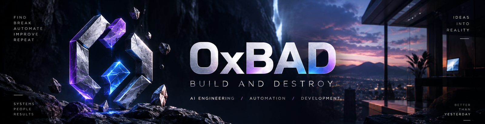
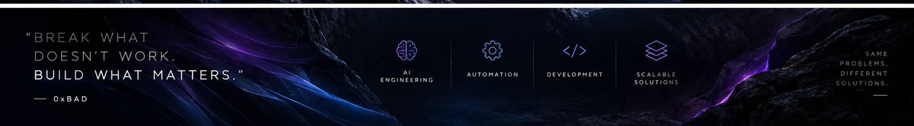

 

### Developer · Builder · Problem Solver

**AI ENGINEERING &nbsp; / &nbsp; BUSINESS AUTOMATION &nbsp; / &nbsp; FULL-CYCLE DEVELOPMENT**

*Find the problem. Break down complexity. Build what works.*

---

## 01 / ABOUT

I design, build, deploy and maintain software that solves real business problems — from discovering bottlenecks and designing architecture to production support.

I work across **AI integrations, automation, backend services and infrastructure**, connecting disconnected tools and turning repetitive processes into reliable systems.

## 02 / WHAT I BUILD

<table>
<tr>
<td width="50%" valign="top">

### AI ENGINEERING

LLM integrations, RAG assistants, MCP tools and AI-powered business workflows.

</td>
<td width="50%" valign="top">

### BUSINESS AUTOMATION

Workflow automation, Telegram bots, marketplace tooling and CRM/ERP integrations.

</td>
</tr>
<tr>
<td width="50%" valign="top">

### SOFTWARE DEVELOPMENT

Python backend services, FastAPI, APIs, PostgreSQL and system integrations.

</td>
<td width="50%" valign="top">

### DEPLOY & OPERATE

Docker, CI/CD, server deployment, monitoring and ongoing production maintenance.

</td>
</tr>
</table>

 

## 03 / TECHNOLOGY

<table>
<tr>
<td valign="top" width="50%">

**BACKEND & DATA**

`Python` · `FastAPI` · `SQLAlchemy` · `PostgreSQL` · `aiogram`

</td>
<td valign="top" width="50%">

**AUTOMATION & INFRASTRUCTURE**

`Docker` · `GitHub Actions` · `n8n` · `CI/CD`

</td>
</tr>
<tr>
<td valign="top">

**AI & INTEGRATIONS**

`LLM APIs` · `RAG` · `MCP`

</td>
<td valign="top">

**AI-ASSISTED DEVELOPMENT**

`Claude` · `Codex` · `GPT`

</td>
</tr>
</table>

## 04 / CURRENT FOCUS

- **AI automation:** useful AI integrations embedded in real business processes.
- **Business systems:** services and integrations that reduce manual work.
- **Full-cycle delivery:** architecture, development, deployment and maintenance.

## 05 / PROJECTS

Most production work is kept in **private repositories**. Public case studies and independent demonstrations will be added only when they can be shared safely.

---

**DISCOVER &nbsp; → &nbsp; DESIGN &nbsp; → &nbsp; BUILD &nbsp; → &nbsp; DEPLOY &nbsp; → &nbsp; MAINTAIN**

### 0xBAD · BUILD AND DESTROY

*Understand what is broken. Remove unnecessary complexity. Build something better.*

